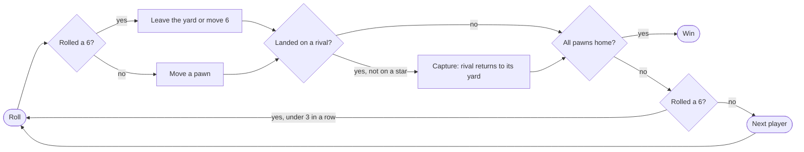

<div align="center">

<a href="docs/video/doodle-ludo-explainer.mp4">
  
</a>

# Doodle Ludo

**A hand-drawn, 3D Ludo game for 2 to 16 players. Runs in your browser. No backend, no install.**

[](LICENSE)
[](https://github.com/YOUR_USERNAME/doodle-ludo/actions/workflows/ci.yml)
[](https://github.com/YOUR_USERNAME/doodle-ludo/actions/workflows/pages.yml)


[Watch the explainer](docs/video/doodle-ludo-explainer.mp4) · [Play](https://YOUR_USERNAME.github.io/doodle-ludo/) · [How it works](#how-it-works) · [Run locally](#run-it-locally)


</div>

---

## Why Doodle Ludo?

Ludo is usually played flat and at four players. This version is a real 3D scene with a hand-drawn look, a rules engine that is tested by simulation, and a board that scales from 2 to 16 players. It is one static page: no accounts, no ads, no server to run.

## Quickstart

```bash
git clone https://github.com/YOUR_USERNAME/doodle-ludo.git
cd doodle-ludo
npm run serve        # builds, then serves http://localhost:8080
```

Open the page, press **Play**, then **Start game**. Tap anywhere to roll. (Needs Node 18+ and a browser with WebGL.)

## About

Doodle Ludo is the classic race-and-capture board game drawn like a doodle on notebook paper, and rendered in real 3D with [Three.js](https://threejs.org/). Pieces are cel-shaded with wobbly ink outlines, the whole scene sits under a paper texture, and every pawn has a face that reacts to what happens on the board.

It is a single static page: **frontend only**, with settings, stats and saved games in `localStorage`.

> Suggested GitHub "About" text: *Hand-drawn 3D Ludo for 2-16 players in the browser. Three.js, pawn expressions, optional pixel-art battle effects, co-op teams, no backend.*

## Features

| | |
|---|---|
| **Doodle look** | Cel-shaded toon materials, inverted-hull ink outlines, paper texture and a post-processing pass. |
| **Classic rules** | 15x15 board, 4 pawns each. Roll a 6 to leave the yard, capture rivals, stars are safe, a 6 gives an extra turn, three 6s in a row forfeit the turn, and you need an exact roll to finish. |
| **2-4 players** | Any seat can be Human, Bot or Off. Bots come in Easy, Normal and Hard. |
| **Co-op teams** | Red + Yellow against Green + Blue. Teammates never capture each other, any roll can move your own or your partner's pawn, and a team wins with all 8 pawns home. |
| **Big board (beta)** | A star-shaped board that scales from **2 to 16 players**, one coloured arm per player. |
| **Tap anywhere to roll** | Tap or click anywhere on the board to roll, or press Space. |
| **Board follows the turn** | The camera turns to face the current seat. Choose Auto, Each turn or Off in Settings. |
| **Pawn expressions** | Pawns look where they are going, cheer when a teammate scores, get angry when they attack, and get scared, dizzy and sad when captured. |
| **Battle effects (opt-in)** | Pixel-art effects from [pixelfx](https://github.com/patch-gg/pixelfx) drawn as planes lying in the board's own 3D space: portals when a pawn leaves the yard, dust on landings, "BONK!" captures, fireworks on a win. **Off by default.** |
| **FX Epic level** | Adds force ripples on the board, screen flashes, hit-stop slow motion and extra effects. |
| **Mobile first** | Responsive menus and HUD, touch drag to pan, pinch to zoom. |
| **Accessible** | Colour-blind symbols on every colour, a Reduced motion setting that turns all effects off, large tap targets. |
| **Sound** | WebAudio effects and music generated in code. There are no audio files. |
| **Online play** | Quick match, private room codes and a leaderboard. See the [note on hosting](#online-play-and-hosting). |

## Screenshots

<table>
  <tr>
    <td></td>
    <td></td>
  </tr>
  <tr>
    <td></td>
    <td></td>
  </tr>
  <tr>
    <td></td>
    <td></td>
  </tr>
  <tr>
    <td></td>
    <td></td>
  </tr>
</table>

<p align="center">
  
  
</p>

## Video

[](docs/video/doodle-ludo-explainer.mp4)

A 2-minute narrated walkthrough of every feature, captured from the game itself. Click the thumbnail to play it. The video is in [`docs/video/`](docs/video/doodle-ludo-explainer.mp4) and the scripts that made it are in [`tools/video`](tools/video).

<!--
INLINE PLAYER (optional, no file stored in the repo):
1. On GitHub click the pencil to edit this README.
2. Drag docs/video/doodle-ludo-explainer.mp4 into the editor. GitHub uploads it and pastes a
   https://github.com/user-attachments/assets/... link (free plan: max 10 MB, paid: 100 MB).
3. Put that link on its own line here, and it renders as a player. Then you can delete docs/video/.

YOUTUBE ALTERNATIVE (no file in the repo, no size limit):
[](https://youtu.be/YOUR_VIDEO_ID)
-->

## How to play

1. Press **Play**, choose who sits in each seat, and press **Start game**.
2. **Tap anywhere** (or press Space) to roll the dice.
3. A **6** brings a pawn out of the yard onto your start square and gives you another roll.
4. Land on a rival pawn on a normal square to send it back to its yard. Pawns on the stars and start squares are **safe**.
5. Walk all four pawns around the board and into the centre. You need the **exact** roll to finish.
6. Three 6s in a row forfeit your turn.

**Controls:** tap/click to roll or pick a pawn, drag to pan, pinch or mouse wheel to zoom, Space to roll, the **FX** button in the HUD to cycle effects Off / On / Epic.

### Battle effects

Effects are **off every time the game starts**. Turn them on from the **FX** button in the HUD or from **Settings > Battle effects**.

| Level | What you get |
|---|---|
| **Off** | No effects, no dust, no particles, no screen shake. |
| **On** | Portals, landing dust, hit sparks, damage numbers, capture pops, power stars, win fireworks. |
| **Epic** | Everything above plus force ripples, screen flashes, hit-stop slow motion, sword slashes, fire rings, flame pillars, a big win explosion and more. |

The effects are depth-tested inside the 3D scene: floor effects lie flat on the board, bursts stand on the ground and are hidden by pieces in front of them, and bursts cast a soft shadow on the board.

## How it works

```
src/
  logic.js          rules engine (pure JS, no DOM)
  style.js          doodle look: toon materials, ink outlines, paper texture, post-FX
  scene.js          Three.js scene: boards, pawns, dice, camera, tweens, expressions
  battle.js         battle effects: pixelfx planes + procedural ripples and flashes
  audio.js          WebAudio sound and music, plus particle bursts (Juice)
  ui.js / ui.css    menus, HUD, settings, dialogs
  net.js            online lobby, quick match, rooms, leaderboard
  main.js           game controller
  pixelfx.bundle.js bundled pixelfx effects (built from tools/fxbuild)
test/logic.test.js  rules engine tests
build.js            concatenates src/ into one dist/index.html
tools/              asset and video tooling (not needed to run the game)
```

- **Plain-JS modules.** Each file is an IIFE that registers on `window.LudoGame`. `build.js` concatenates them into one self-contained HTML file. Three.js r128 loads from a CDN.
- **Rules engine.** `logic.js` is pure and deterministic given a die value, so it is tested without a browser. Positions are encoded as `-1` yard, `0..ring-2` track, then a 5-cell home column, then `fin`. The classic ring is 52 cells; the big board uses `ring = 13 x players`.
- **Big board.** `Logic.layout(n)` generates an N-arm star for any N from 2 to 16.
- **Camera.** The camera azimuth (`yaw`) eases towards the current seat. Modes are `turn`, `seat` and `fixed`.
- **Expressions.** Pawn faces are small meshes toggled from a table of expressions. Gaze and speech bubbles react to game events.
- **Effects.** pixelfx renders pixel frames to a canvas, which becomes a `CanvasTexture` on a plane with nearest-neighbour filtering. Planes are depth-tested, so they sit inside the scene. The setting `battle` (`off` | `normal` | `epic`) gates every effect and every particle, and it is reset to `off` on each launch.
- **Persistence.** Settings, stats and the saved game live in `localStorage`.


### Game flow (renders natively on GitHub, no image file)



### The board in a code block

```
        GREEN yard      | yellow lane |   YELLOW yard
       (o)   (o)        |  . . .      |   (o)   (o)
       (o)   (o)        |  . Y Y      |   (o)   (o)
   ---------------------+-------------+---------------------
    . G G G G G         |    *HOME*   |         B B B B B .
   ---------------------+-------------+---------------------
        RED yard        |  . R R      |    BLUE yard
       (o)   (o)        |  . . .      |   (o)   (o)
       (o)   (o)        |  roll here  |   (o)   (o)
```

### Tests

```bash
npm test
```

Plays 500 classic games, 30 games for every player count from 2 to 16 on the big board, and 60 co-op games with random bots, asserting the rules engine's invariants along the way.

## Run it locally

You only need Node 18+ to build. There are no runtime dependencies.

```bash
git clone https://github.com/YOUR_USERNAME/doodle-ludo.git
cd doodle-ludo
npm test           # rules engine tests
npm run build      # writes dist/index.html
npm run serve      # builds and serves dist/ on http://localhost:8080
```

`dist/index.html` is a single file. You can also open it directly in a browser.

To rebuild the bundled effects after editing `tools/fxbuild/entry.js` (this needs a local clone of [pixelfx](https://github.com/patch-gg/pixelfx); edit the import paths in `entry.js` to point at it):

```bash
npm run build:fx
```

## Deploy

Push to `main` and the included workflow (`.github/workflows/pages.yml`) builds and publishes `dist/` to **GitHub Pages**. Enable it once under *Settings > Pages > Source: GitHub Actions*.

## Online play and hosting

Online play (quick match, private rooms, leaderboard) uses the shared database and sign-in that the **Claude Artifacts** runtime provides (`window.claude`). That means:

- When the page is hosted as a **Claude Artifact**, online play works for viewers with write access.
- When it is hosted on GitHub Pages or any other static host, **single-device play, co-op, the big board, effects and mobile all work, but online play shows a "needs a signed-in claude.ai viewer" message.**
- Online play was tested against a mock database, not against two real players.

To run online play on your own host, replace the storage calls in `src/net.js` with your own backend (the file isolates them behind a small set of read, write, watch and acquire helpers).

## Known limitations

- Online play is only exercised against a mock, as described above.
- The beta big board outline is a little blobby.
- On boards with six or more players the pawns do not have faces.
- The 16-player board is playable but its frame rate on low-end devices has not been measured.
- Epic explosions leave some dark smoke.

## Roadmap

- [ ] A pluggable backend for online rooms (WebSocket or WebRTC) so it works on any host
- [ ] Faces on big-board pawns
- [ ] Replay and undo
- [ ] More board themes (crayon, chalkboard, graph paper)
- [ ] Daily challenge and shareable seeds
- [ ] PWA install and offline mode

## Credits

- [Three.js](https://threejs.org/) (MIT) for rendering.
- [pixelfx](https://github.com/patch-gg/pixelfx) (MIT) for the pixel-art battle effects.
- [coop-anything](https://github.com/cranebeaker/coop-anything) by cranebeaker, the inspiration for the co-op mode.
- [claude-animation-skills](https://github.com/artemnovitckii/claude-animation-skills) and [claude-code-video-toolkit](https://github.com/digitalsamba/claude-code-video-toolkit) for the ideas behind the explainer video (impact bursts, whip cuts, audio-anchored timing, burned-in captions).
- [Kokoro](https://github.com/thewh1teagle/kokoro-onnx) text-to-speech for the video narration.
- Fonts: Patrick Hand and Gochi Hand (Google Fonts, OFL), Poppins (OFL, video only).

Built with [Claude Code](https://claude.com/claude-code).

## License

[MIT](LICENSE). The bundled pixelfx and Three.js code keep their own MIT licenses.
